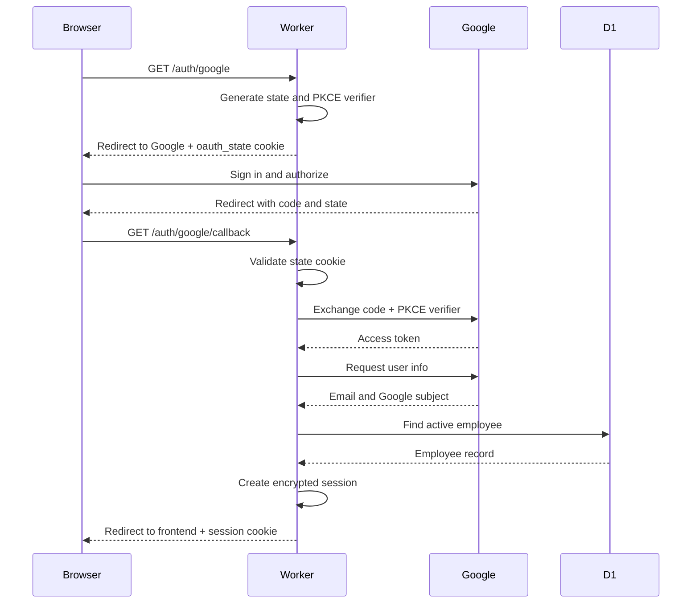

# Authentication flow

This diagram maps the browser sign-in flow to the Worker, Google OAuth, and D1
operations. The links below each step point to the relevant source location so
the implementation can be checked directly in VS Code.



## Detailed flow explanation

### 1. The frontend starts sign-in

When an unauthenticated visitor loads the frontend, [`load()` in
`frontend/app.js`](../frontend/app.js) calls `GET /api/me`. The Worker checks
for a valid `session` cookie. If there is no valid session, the Worker returns
HTTP 401 and the frontend sets the Google sign-in link to
`/auth/google`.

The browser then requests [`/auth/google` in `worker/src/index.js`](../worker/src/index.js).
The route is intentionally public: a user must be able to reach it before an
application session exists. The route dispatches to
[`handleLogin`](../worker/src/auth.js), which begins the OAuth transaction.

### 2. The Worker creates OAuth state and PKCE values

[`handleLogin`](../worker/src/auth.js) creates two separate random values:

- `state` identifies this particular sign-in attempt and prevents an attacker
  from injecting a callback from another browser session.
- `codeVerifier` is a secret generated by the Worker for PKCE. The Worker
  derives `codeChallenge = SHA-256(codeVerifier)` and sends only the challenge
  to Google initially.

The Worker also calculates the callback URL from the incoming request origin:

```text
<worker-origin>/auth/google/callback
```

That same URL must be used both in the Google authorization request and in the
later token exchange. A mismatch causes Google to reject the exchange.

The state and verifier are placed in an encrypted `oauth_state` cookie using
[`createSession`](../worker/src/session.js). The cookie is short-lived because
it is only needed while the user completes the Google sign-in. The Worker then
redirects the browser to Google with the `state`, `code_challenge`, and
`code_challenge_method=S256` parameters.

### 3. Google authenticates the user

The browser follows the redirect to Google. Google authenticates the user and
asks for the requested OpenID Connect scopes: `openid`, `email`, and `profile`.
The browser does not send the Google access token to the frontend application.

After authorization, Google redirects the browser to the Worker callback with
two important query parameters:

```text
/auth/google/callback?code=<one-time-code>&state=<original-state>
```

The authorization code is temporary and cannot be used by itself without the
PKCE verifier that was created before the redirect.

### 4. The Worker validates the callback

The callback is routed by [`fetch`](../worker/src/index.js); search for
`url.pathname === '/auth/google/callback'`. It dispatches to
[`handleCallback`](../worker/src/auth.js).

`handleCallback` first checks that both `code` and `state` are present. It then
reads the encrypted `oauth_state` cookie with [`parseCookies` and
`readSession`](../worker/src/session.js). The returned state must equal the
stored state. If the cookie is missing, expired, tampered with, or does not
match, the callback stops with HTTP 403 and no application session is created.

This check binds the callback to the browser that initiated the sign-in. The
PKCE verifier provides a second independent check when the code is exchanged.

### 5. The Worker exchanges the code with Google

After state validation, [`handleCallback`](../worker/src/auth.js) sends a
server-to-server POST request to `GOOGLE_TOKEN_URL`. The request includes:

- The one-time authorization `code`.
- `GOOGLE_CLIENT_ID` and the secret `GOOGLE_CLIENT_SECRET`.
- The same callback URL used during authorization.
- The original `code_verifier` from the encrypted cookie.
- `grant_type=authorization_code`.

Google checks the code, redirect URI, client credentials, and PKCE verifier. If
the exchange fails, the Worker returns HTTP 400 and does not create a session.
The tokens remain between the Worker and Google; they are not returned to the
frontend.

### 6. The Worker reads the Google identity

Using the returned access token, [`handleCallback`](../worker/src/auth.js)
requests Google UserInfo at `GOOGLE_USERINFO_URL`. The response supplies:

- `email`, used to match the employee directory.
- `sub`, Google’s stable subject identifier for the account.

The Worker requires an email before continuing. The `sub` value is preferable
for future matching because an email address can change while the Google
subject remains stable.

### 7. The Worker authorizes the employee against D1

The employee lookup in [`handleCallback`](../worker/src/auth.js) searches the
`employees` table by `cf_sub` or email. Both values are passed through D1
parameter binding rather than string concatenation.

The account must exist and have `is_active = 1`. A Google account that is not
in the employee directory, or an employee that has been deactivated, receives
HTTP 403. Authentication by Google alone is therefore not sufficient to enter
the Task Portal; the application’s employee-directory authorization check is
also required.

For a first successful login found by email, the Worker stores Google’s `sub`
in `employees.cf_sub`. This is the backfill step in the
[`if (!employee.cf_sub)` block](../worker/src/auth.js).

### 8. The Worker creates the application session

After D1 authorization, the Worker creates a new encrypted session with
[`createSession`](../worker/src/session.js). The payload contains the minimum
application identity needed by the portal:

```text
employeeId, email, isAdmin, exp
```

`session.js` encrypts the payload with AES-GCM and adds a seven-day expiration.
Later, [`readSession`](../worker/src/session.js) decrypts the cookie, checks
the expiration, and returns `null` if the cookie is malformed, tampered with,
or expired.

The Worker sends the encrypted value as the `session` cookie and redirects the
browser to `FRONTEND_URL`. The browser does not need to understand the cookie
contents.

### 9. Authenticated requests use the session cookie

On the next page load, the frontend calls `/api/me` and includes cookies with
`credentials: 'include'`; see [`api()` in `frontend/app.js`](../frontend/app.js).

The central Worker request handler reads the cookie using
[`readSession`](../worker/src/session.js). Requests without a valid session
receive HTTP 401. For `/api/me` and admin routes, the Worker also reloads the
employee from D1 using [`getEmployeeAuth`](../worker/src/db.js). This second
check ensures that an employee who was deactivated after login no longer has
access and that the current `is_admin` value is used.

The Worker returns only the fields needed by the frontend from `/api/me`: email,
employee ID, and admin status. Task and schedule handlers then use the
authenticated employee ID to scope protected data.

### 10. Logout expires the session

When the user selects Log out, the frontend redirects to `/auth/logout`. The
Worker calls [`handleLogout`](../worker/src/auth.js), sends an expired `session`
cookie, and redirects to `FRONTEND_URL`. Subsequent API requests no longer
have a valid session and return HTTP 401 until the user signs in again.

## Code checkpoints

Use the following links as code-position references. In VS Code, opening a link
to a source file lets you inspect the surrounding implementation; the symbols
and search strings make the exact checkpoint easy to locate even if line
numbers change.

| Flow step | Source location | What to verify |
| --- | --- | --- |
| Start sign-in | [`handleLogin`](../worker/src/auth.js) — search `export async function handleLogin` | `state` and `codeVerifier` are generated with Web Crypto; the redirect URI is the Worker callback; the Google URL includes `state`, `code_challenge`, and `code_challenge_method=S256`. |
| Protect OAuth state | [`createSession`](../worker/src/session.js) — search `export async function createSession` | The OAuth state and verifier are encrypted before being stored in `oauth_state`; the cookie is short-lived. |
| Route the callback | [`fetch`](../worker/src/index.js) — search `url.pathname === '/auth/google/callback'` | The Worker sends callback requests to `handleCallback` before requiring an application session. |
| Validate callback input | [`handleCallback`](../worker/src/auth.js) — search `Missing code or state` | Missing `code` or `state` is rejected with HTTP 400. |
| Validate CSRF state | [`handleCallback`](../worker/src/auth.js) — search `Invalid state (CSRF protection)` | The returned Google state matches the decrypted `oauth_state` cookie. |
| Exchange the code | [`handleCallback`](../worker/src/auth.js) — search `GOOGLE_TOKEN_URL` | The token request uses the configured client credentials, the same redirect URI, and the original PKCE verifier. |
| Read Google identity | [`handleCallback`](../worker/src/auth.js) — search `GOOGLE_USERINFO_URL` | The access token is sent to Google UserInfo and the response supplies `email` and stable `sub`. |
| Authorize the employee | [`handleCallback`](../worker/src/auth.js) — search `FROM employees WHERE cf_sub` | The account must match the employee directory and be active; the SQL uses bound parameters. |
| Backfill identity | [`handleCallback`](../worker/src/auth.js) — search `if (!employee.cf_sub)` | A first login stores Google’s stable subject against the existing employee record. |
| Create app session | [`handleCallback`](../worker/src/auth.js) — search `const session = await createSession` | The session contains only the employee ID, email, and admin flag, and is written as the `session` cookie. |
| Encrypt and validate session | [`createSession` / `readSession`](../worker/src/session.js) — search `AES-GCM` | Session data is encrypted, has an expiration timestamp, and tampered or expired cookies return `null`. |
| Enforce protected routes | [`fetch`](../worker/src/index.js) — search `const session = await readSession` | Requests without a valid session receive HTTP 401; admin and `/api/me` requests re-check the current employee in D1. |
| Load the signed-in user | [`fetch`](../worker/src/index.js) — search `url.pathname === '/api/me'` | The response exposes the current email, employee ID, and admin status without exposing tokens. |
| Sign out | [`handleLogout`](../worker/src/auth.js) — search `export function handleLogout` | The session cookie is expired and the browser is redirected to `FRONTEND_URL`. |

## Recommended ways to reference external code positions

Line numbers are useful for a snapshot but become stale after edits. Prefer
stable references in this order:

1. **File + exported symbol** — for example, `worker/src/auth.js`,
   `handleCallback`.
2. **File + unique search string** — for example, search
   `Invalid state (CSRF protection)`.
3. **File + route string** — for example, search
   `/auth/google/callback` in `worker/src/index.js`.
4. **Git permalink with line range** — use this for a reviewed commit, such as
   `worker/src/auth.js#L70-L120`; refresh it after new commits.
5. **Request/response contract** — pair the code location with the expected
   method, status, redirect, cookie, or JSON response from [`APIDOC.md`](../APIDOC.md).

For each checkpoint, record four things: the input, the security or business
rule, the output, and the failure response. For example:

```text
Checkpoint: worker/src/auth.js — handleCallback — GOOGLE_TOKEN_URL
Input: code, redirect_uri, code_verifier
Rule: exchange only with the verifier created before the Google redirect
Success: Google token response, then UserInfo request
Failure: HTTP 400 with no application session created
```

## Practical verification

- Use browser DevTools Network to confirm the redirects, callback status, and
  absence of access tokens in frontend requests.
- Inspect cookie attributes and confirm `Secure`, `HttpOnly`, `Path=/`, and an
  appropriate `SameSite` value.
- Call `/api/me` while signed out and confirm HTTP 401.
- Sign in with an employee absent from D1 or marked inactive and confirm HTTP
  403 from the callback.
- After signing in, call `/api/me` and confirm the returned `employeeId` and
  `isAdmin` match D1.
- Use Wrangler logs or controlled error responses to distinguish Google token
  failures, invalid OAuth state, and missing employee records without logging
  cookies, tokens, or secrets.