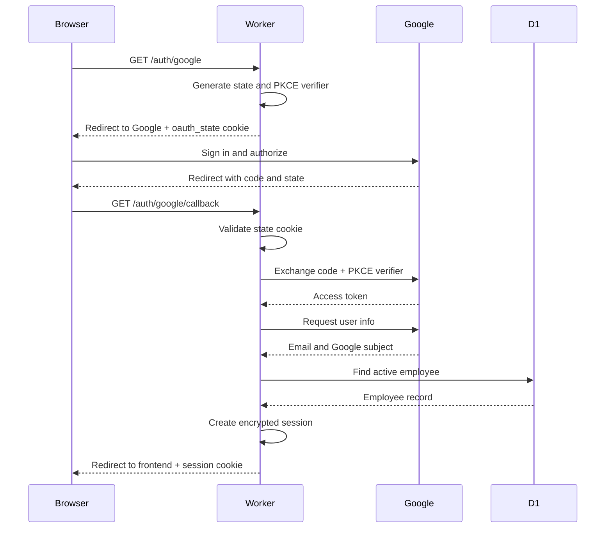

# Authentication flow

This diagram maps the browser sign-in flow to the Worker, Google OAuth, and D1
operations. The links below each step point to the relevant source location so
the implementation can be checked directly in VS Code.



## Code checkpoints

Use the following links as code-position references. In VS Code, opening a link
to a source file lets you inspect the surrounding implementation; the symbols
and search strings make the exact checkpoint easy to locate even if line
numbers change.

| Flow step | Source location | What to verify |
| --- | --- | --- |
| Start sign-in | [`handleLogin`](../worker/src/auth.js) — search `export async function handleLogin` | `state` and `codeVerifier` are generated with Web Crypto; the redirect URI is the Worker callback; the Google URL includes `state`, `code_challenge`, and `code_challenge_method=S256`. |
| Protect OAuth state | [`createSession`](../worker/src/session.js) — search `export async function createSession` | The OAuth state and verifier are encrypted before being stored in `oauth_state`; the cookie is short-lived. |
| Route the callback | [`fetch`](../worker/src/index.js) — search `url.pathname === '/auth/google/callback'` | The Worker sends callback requests to `handleCallback` before requiring an application session. |
| Validate callback input | [`handleCallback`](../worker/src/auth.js) — search `Missing code or state` | Missing `code` or `state` is rejected with HTTP 400. |
| Validate CSRF state | [`handleCallback`](../worker/src/auth.js) — search `Invalid state (CSRF protection)` | The returned Google state matches the decrypted `oauth_state` cookie. |
| Exchange the code | [`handleCallback`](../worker/src/auth.js) — search `GOOGLE_TOKEN_URL` | The token request uses the configured client credentials, the same redirect URI, and the original PKCE verifier. |
| Read Google identity | [`handleCallback`](../worker/src/auth.js) — search `GOOGLE_USERINFO_URL` | The access token is sent to Google UserInfo and the response supplies `email` and stable `sub`. |
| Authorize the employee | [`handleCallback`](../worker/src/auth.js) — search `FROM employees WHERE cf_sub` | The account must match the employee directory and be active; the SQL uses bound parameters. |
| Backfill identity | [`handleCallback`](../worker/src/auth.js) — search `if (!employee.cf_sub)` | A first login stores Google’s stable subject against the existing employee record. |
| Create app session | [`handleCallback`](../worker/src/auth.js) — search `const session = await createSession` | The session contains only the employee ID, email, and admin flag, and is written as the `session` cookie. |
| Encrypt and validate session | [`createSession` / `readSession`](../worker/src/session.js) — search `AES-GCM` | Session data is encrypted, has an expiration timestamp, and tampered or expired cookies return `null`. |
| Enforce protected routes | [`fetch`](../worker/src/index.js) — search `const session = await readSession` | Requests without a valid session receive HTTP 401; admin and `/api/me` requests re-check the current employee in D1. |
| Load the signed-in user | [`fetch`](../worker/src/index.js) — search `url.pathname === '/api/me'` | The response exposes the current email, employee ID, and admin status without exposing tokens. |
| Sign out | [`handleLogout`](../worker/src/auth.js) — search `export function handleLogout` | The session cookie is expired and the browser is redirected to `FRONTEND_URL`. |

## Recommended ways to reference external code positions

Line numbers are useful for a snapshot but become stale after edits. Prefer
stable references in this order:

1. **File + exported symbol** — for example, `worker/src/auth.js`,
   `handleCallback`.
2. **File + unique search string** — for example, search
   `Invalid state (CSRF protection)`.
3. **File + route string** — for example, search
   `/auth/google/callback` in `worker/src/index.js`.
4. **Git permalink with line range** — use this for a reviewed commit, such as
   `worker/src/auth.js#L70-L120`; refresh it after new commits.
5. **Request/response contract** — pair the code location with the expected
   method, status, redirect, cookie, or JSON response from [`APIDOC.md`](../APIDOC.md).

For each checkpoint, record four things: the input, the security or business
rule, the output, and the failure response. For example:

```text
Checkpoint: worker/src/auth.js — handleCallback — GOOGLE_TOKEN_URL
Input: code, redirect_uri, code_verifier
Rule: exchange only with the verifier created before the Google redirect
Success: Google token response, then UserInfo request
Failure: HTTP 400 with no application session created
```

## Practical verification

- Use browser DevTools Network to confirm the redirects, callback status, and
  absence of access tokens in frontend requests.
- Inspect cookie attributes and confirm `Secure`, `HttpOnly`, `Path=/`, and an
  appropriate `SameSite` value.
- Call `/api/me` while signed out and confirm HTTP 401.
- Sign in with an employee absent from D1 or marked inactive and confirm HTTP
  403 from the callback.
- After signing in, call `/api/me` and confirm the returned `employeeId` and
  `isAdmin` match D1.
- Use Wrangler logs or controlled error responses to distinguish Google token
  failures, invalid OAuth state, and missing employee records without logging
  cookies, tokens, or secrets.